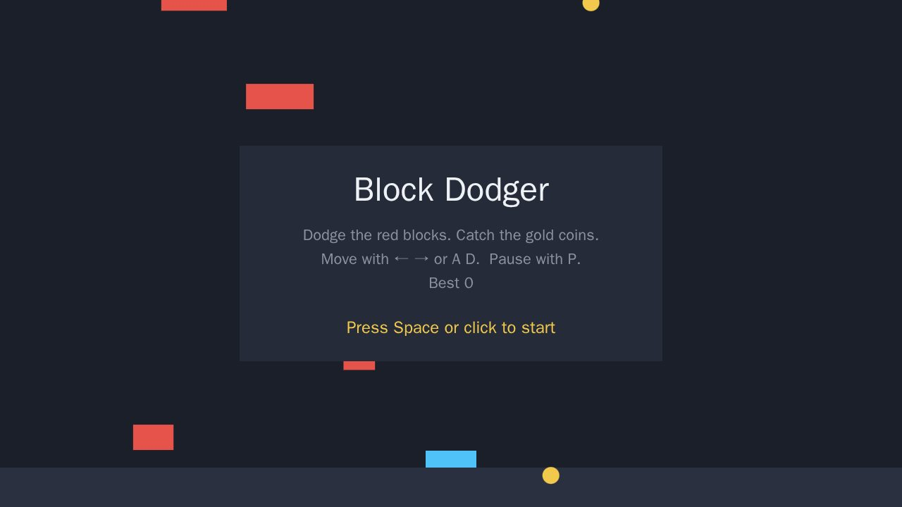

# Cyber Strike: Neon Defender ⚡🕹️

[](https://make.fun/bounty/best-game-01?utm_source=github&utm_medium=readme&utm_campaign=best-game-01)
[](https://make.fun/bounty/best-game-01/leaderboard?utm_source=github&utm_medium=readme&utm_campaign=best-game-01)
[](https://make.fun/bounty/best-game-01?utm_source=github&utm_medium=readme&utm_campaign=best-game-01)

A high-octane retro synthwave arcade space shooter built for the [make.fun best-game-01 bounty](https://make.fun/bounty/best-game-01). Completely self-contained, 100% offline, zero external dependencies or network requests.



---

## 🌟 Game Highlights

- **Vibrant Synthwave Aesthetics**: 2D HTML5 Canvas rendering featuring glowing neon vector spacecraft, multi-layered parallax starfields with warp-speed transitions, and dynamic synthwave perspective grids.
- **Buttery Smooth 60 FPS Game Loop**: Fixed/delta-time physics with responsive keyboard, mouse, and touch controls.
- **Dynamic Procedural Audio**: Built entirely on the Web Audio API with zero external audio assets. Features procedural laser synthesis, multi-frequency explosion rumbles with white-noise buffers, powerup chimes, shield deflections, and an authentic looping 124 BPM synthwave bassline & melody generator.
- **Weapon & Upgrade Progression**:
  - **Level 1**: Single Precision Neon Bolt
  - **Level 2**: Twin Heavy Blasters
  - **Level 3**: Triple Spread Laser
  - **Level 4**: Quad Overdrive Blaster with Wide Spread
  - **EMP Nova Bomb**: Screen-clearing blast that vaporizes enemy bullets and damages all hostile units.
  - **Overdrive Mode**: Temporary hyper-fire and invulnerability.
- **Diverse Enemy Armada & Epic Bosses**:
  - *Neon Scouts*: Agile sinewave swarmers.
  - *Cyber Fighters*: Twin-aiming interceptors.
  - *Grid Sweepers*: High-speed diving raiders.
  - *Armored Cruisers*: Heavy gunships firing 3-way plasma salvos.
  - *Boss Flagship ("Neon Dreadnought")*: Massive multi-core boss with radial bullet bursts and targeted barrages encountered every 5 waves.
- **Juicy FX & Polish**:
  - Dynamic spark, debris, and shockwave particle systems.
  - Screen shake on explosions and heavy impacts.
  - Floating combo score badges and HUD health/shield indicators.
  - High score persistence via local storage.

---

## 🎮 Controls

| Action | Keyboard | Mouse / Touch |
| :--- | :--- | :--- |
| **Move** | `W`, `A`, `S`, `D` or `Arrow Keys` | Mouse Movement / Touch Drag |
| **Fire Blasters** | `Spacebar` (Hold for continuous fire) | Left Mouse Button / Tap & Hold |
| **Deploy EMP Bomb** | `B` | Right Mouse Button |
| **Pause / Resume** | `P` | Pause Button (HUD) |
| **Toggle Audio** | `M` | Sound Button (HUD) |
| **Fullscreen** | `F` | — |

---

## 🚀 How to Run Locally

Because the game uses standard ES modules (`<script type="module">`), run a lightweight local static file server from the root or `game/` folder:

```bash
# Using Node.js built-in static server or npx
npx serve game

# Or with Python 3
python -m http.server 8000 -d game
```

Open your browser to `http://localhost:8000` or `http://localhost:3000`.

---

## 📦 Building the Dossier

The bounty entrypoint is `main.ts` (Node 22+). It copies the game and screenshots into the output directory and compiles the canonical `dossier.json` using `./vendor/makefun-game.ts`:

```bash
node main.ts
```

Output is written to `$MAKEFUN_OUTPUT_DIR` (defaults to `/output`).

---

## 🛡️ Architecture & File Structure

```text
cyber-strike-game/
├── .makefun/
│   └── owner.json            # Bounty owner credentials
├── game/
│   ├── index.html            # Main game entry page
│   ├── style.css             # Cyberpunk CRT scanline and layout styling
│   └── src/
│       ├── audio.js          # Web Audio procedural sound & music generator
│       ├── entities.js       # Starfield, Player, Enemy, Boss, Projectile, PowerUp classes
│       ├── game.js           # Game controller, wave manager, input, collision detection
│       ├── main.js           # Bootstrapper, UI binding, event listeners
│       └── particles.js      # Particle pool, shockwaves, floating text, screen shake
├── screenshots/
│   ├── 1-start.jpg           # Title / Start screen (Cover)
│   ├── 2-play.jpg            # In-game combat action
│   └── 3-end.jpg             # Game over screen
├── vendor/
│   └── makefun-game.ts       # Makefun game library
├── LICENSE
├── main.ts                   # Bounty entrypoint
└── README.md                 # Project documentation
```

100% offline, self-contained, and ready for deployment!
